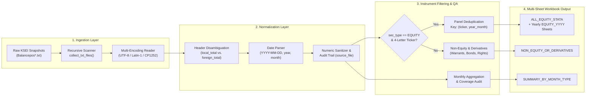
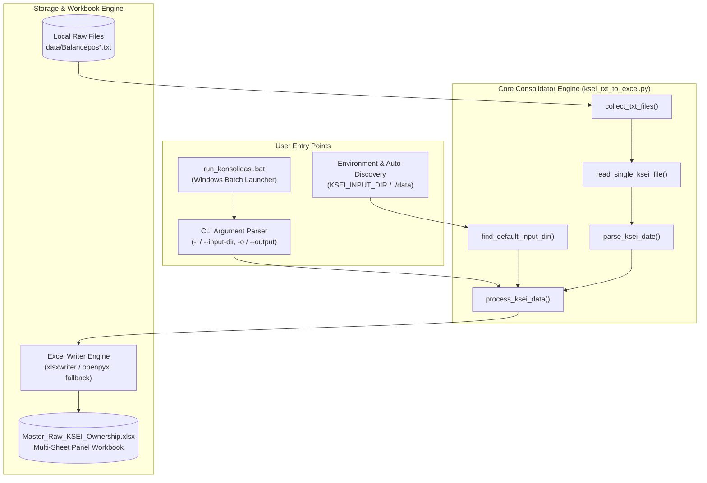

# KSEI Ownership Consolidator (`ksei-ownership-consolidator`)


An automated ETL consolidator that transforms monthly pipe-delimited securities ownership snapshots (`Balancepos*.txt`) from the Indonesia Central Securities Depository (KSEI) into a validated, multi-sheet Excel workbook formatted for longitudinal panel data regression in Stata, Python, or R.

---

## Executive Overview & Core Capabilities

Monthly KSEI securities ownership disclosures distribute investor holdings across dozens of standalone `.txt` files with structural quirks that break direct statistical imports. `ksei-ownership-consolidator` resolves these challenges deterministically while preserving raw share counts without rounding or premature aggregation:

* **Duplicate Header Disambiguation**: Raw KSEI files contain two identically named `Total` columns on every row (column 15 for domestic holdings and column 25 for foreign holdings). The parser binds positional headers explicitly and maps them to `local_total` and `foreign_total`.
* **Pure Common Equity Isolation**: Separates 4-letter IDX common equities (`sec_type == 'EQUITY'` and `^[A-Z]{4}$`) from corporate bonds, government sukuk, structured warrants, rights issues, and preferred shares so non-equity instruments never contaminate panel regressions.
* **Multi-Encoding Resilience**: Sequentially attempts `UTF-8`, `Latin-1`, and `CP1252` decoding to process both legacy and modern KSEI monthly releases without manual file conversion.
* **Longitudinal Panel Deduplication**: Enforces uniqueness across `(ticker, year_month)` keys to guard against overlapping snapshot folders and sorts output in strict `(ticker, report_date)` panel order.
* **Built-In Monthly Reconciliation**: Generates a cross-check summary table (`SUMMARY_BY_MONTH_TYPE`) aggregating unique tickers, observation counts, listed shares, and domestic/foreign scripless holdings per month.

---

## End-to-End Data Pipeline



---

## System Architecture & Module Map



---

## Output Workbook Schema

Running the consolidator produces a single Excel workbook (`Master_Raw_KSEI_Ownership.xlsx` by default) organized into four sheet groups:

| Sheet Name | Contents | Primary Use |
| :--- | :--- | :--- |
| `ALL_EQUITY_STATA` | Full longitudinal panel of 4-letter IDX common equities, deduplicated on `(ticker, year_month)` and sorted by `ticker`, `report_date`. | Direct import into Stata (`xtset`), Python, or R for panel regressions. |
| `EQUITY_<YYYY>` | Annual slices of pure equity observations (e.g., `EQUITY_2020` through `EQUITY_2026`). | Single-year inspection and cross-sectional checks. |
| `NON_EQUITY_OR_DERIVATIVES` | All non-common-stock instruments (bonds, sukuk, structured warrants, rights, preferred shares). | Fixed-income or derivative ownership research. |
| `SUMMARY_BY_MONTH_TYPE` | Monthly aggregate counts of unique tickers, rows, listed shares, and local/foreign scripless holdings by instrument category. | Data completeness verification and missing-month detection. |

### Variable Dictionary (`ALL_EQUITY_STATA`)

| Variable | Type | KSEI Raw Field | Description |
| :--- | :--- | :--- | :--- |
| `report_date_str` | `string` | `Date` | Original KSEI snapshot date string (e.g., `31-OCT-2023`). |
| `report_date` | `string` | *(Derived)* | ISO-8601 date (`YYYY-MM-DD`). |
| `year_month` | `string` | *(Derived)* | Year-month period identifier (`YYYY-MM`). |
| `year`, `month` | `int` | *(Derived)* | Calendar year and month integers. |
| `ticker` | `string` | `Code` | Security code / IDX ticker symbol. |
| `sec_type` | `string` | `Type` | KSEI security classification (`EQUITY`, `CORPORATE BOND`, etc.). |
| `sec_num_listed` | `numeric` | `Sec. Num` | Total listed shares recorded in KSEI. |
| `price_ksei` | `numeric` | `Price` | Reference closing price reported by KSEI for the snapshot date. |
| `local_is` / `foreign_is` | `numeric` | `Local IS` / `Foreign IS` | Insurance companies (*Insurance*). |
| `local_cp` / `foreign_cp` | `numeric` | `Local CP` / `Foreign CP` | Corporate entities (*Corporate*). |
| `local_pf` / `foreign_pf` | `numeric` | `Local PF` / `Foreign PF` | Pension funds (*Pension Fund*). |
| `local_ib` / `foreign_ib` | `numeric` | `Local IB` / `Foreign IB` | Financial institutions / banks (*Financial Institution*). |
| `local_id` / `foreign_id` | `numeric` | `Local ID` / `Foreign ID` | Retail / individual investors (*Individual*). |
| `local_mf` / `foreign_mf` | `numeric` | `Local MF` / `Foreign MF` | Mutual funds (*Mutual Fund*). |
| `local_sc` / `foreign_sc` | `numeric` | `Local SC` / `Foreign SC` | Securities companies / broker-dealers (*Securities Company*). |
| `local_fd` / `foreign_fd` | `numeric` | `Local FD` / `Foreign FD` | Foundations (*Foundation*). |
| `local_ot` / `foreign_ot` | `numeric` | `Local OT` / `Foreign OT` | Other institutional holders (*Others*). |
| `local_total` | `numeric` | `Total` (Col 15) | Total domestic scripless shares held in KSEI. |
| `foreign_total` | `numeric` | `Total` (Col 25) | Total foreign scripless shares held in KSEI. |
| `source_file` | `string` | *(Derived)* | Source `.txt` filename for row-level audit traceability. |

---

## Project Directory Structure

```text
ksei-ownership-consolidator/
├── data/
│   └── .gitkeep               # Drop folder for raw KSEI Balancepos*.txt snapshots
├── ksei_txt_to_excel.py       # Core ETL consolidator engine and CLI entry point
├── run_konsolidasi.bat        # Windows one-click batch launcher
├── requirements.txt           # Pinned Python dependencies (pandas, numpy, xlsxwriter, openpyxl)
├── .gitignore                 # Excludes virtual environments, raw data, and generated Excel files
├── LICENSE                    # MIT License
└── README.md                  # Architecture, schema, and usage documentation
```

---

## Quickstart & Configuration Guide

### 1. Prerequisites & Installation

Requires **Python 3.10+**. Clone the repository and initialize a virtual environment:

```bash
git clone https://github.com/ElemHD/ksei-ownership-consolidator.git
cd ksei-ownership-consolidator

python -m venv .venv

# Activate on Windows (PowerShell)
.\.venv\Scripts\Activate.ps1

# Activate on macOS / Linux
source .venv/bin/activate

pip install -r requirements.txt
```

### 2. Placing Input Files

Copy your monthly KSEI `Balancepos*.txt` snapshots into the `./data` folder (recursive subdirectories such as `./data/2020/`, `./data/2021/` are automatically traversed), or point the CLI to any external directory.

---

## Usage & Command Reference

### CLI Options

| Flag | Long Option | Default | Description |
| :--- | :--- | :--- | :--- |
| `-i` | `--input-dir` | Auto-detected (`./data`, `KSEI_INPUT_DIR`) | Directory containing KSEI `Balancepos*.txt` files. |
| `-o` | `--output` | `Master_Raw_KSEI_Ownership.xlsx` | Target path for the generated multi-sheet Excel workbook. |

### Execution Examples

```bash
# Run with default ./data folder and default output filename
python ksei_txt_to_excel.py

# Specify custom input directory and output workbook path
python ksei_txt_to_excel.py -i "./data" -o "Master_Raw_KSEI_Ownership.xlsx"
```

On Windows, you can also set `KSEI_INPUT_DIR` or double-click `run_konsolidasi.bat`:

```powershell
$env:KSEI_INPUT_DIR = "D:\Datasets\KSEI_Snapshots"
python ksei_txt_to_excel.py
```

---

## Downstream Panel Setup in Stata

Once `Master_Raw_KSEI_Ownership.xlsx` is generated, run the following commands in Stata to declare the panel structure and compute investor ownership proportions:

```stata
* 1. Import the deduplicated common equity sheet
import excel "Master_Raw_KSEI_Ownership.xlsx", sheet("ALL_EQUITY_STATA") firstrow clear

* 2. Parse dates and declare monthly panel structure (xtset)
gen date_stata = date(report_date, "YMD")
format date_stata %td
gen ym_stata = mofd(date_stata)
format ym_stata %tm
encode ticker, gen(id_emiten)
xtset id_emiten ym_stata

* 3. Compute total scripless shares recorded in KSEI (Domestic + Foreign)
gen double total_scripless = local_total + foreign_total

* 4. Compute ownership proportion examples (e.g., Domestic Retail / Individual Investors)
*    a. Share of total scripless float in KSEI
gen double prop_retail_scripless = local_id / total_scripless if total_scripless > 0

*    b. Share of total listed shares
gen double prop_retail_listed    = local_id / sec_num_listed  if sec_num_listed > 0

* 5. Inspect distribution
summarize prop_retail_scripless prop_retail_listed, detail
```

---

## License

Released under the [MIT License](LICENSE).
